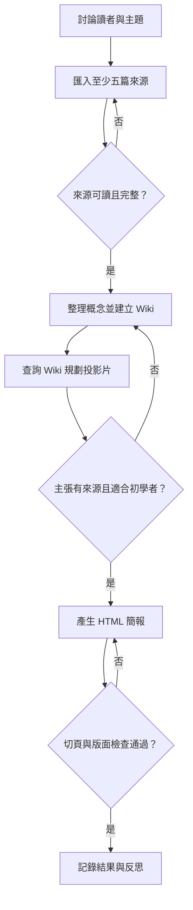

# Loop / Graph 設計

**重複節點：**資料讀取失敗時重試匯入或更換來源；Wiki 缺少依據時回到整理；簡報大綱不清或主張無來源時重查 Wiki；HTML 操作或排版錯誤時修正後重看。

**檢查往前移：**在投影片生成前先核對大綱與來源對應、初學者理解難度，降低整份簡報完成後才發現內容問題的機率。最終仍需瀏覽器人工檢查。

**為何這樣設計：**各節點檢查對應不同產物，較容易定位錯誤；來源、內容與呈現分開驗收，也避免把排版錯誤誤當成知識錯誤。